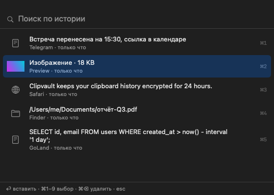

# Clipvault

Encrypted clipboard history for macOS with a fixed 24-hour retention window.

Press <kbd>⇧⌘V</kbd>, search, press <kbd>⏎</kbd>. Every record is encrypted at rest with a key
held in the macOS Keychain and is deleted after 24 hours unless you pin it.

[](https://github.com/Kamaliev/clipvault/actions/workflows/ci.yml)
[](https://github.com/Kamaliev/clipvault/releases/latest)
[](LICENSE)



## Installation

Requires macOS 14 or later (Apple silicon and Intel).

```sh
brew install --cask Kamaliev/tap/clipvault
```

Releases are signed ad hoc, not notarized. The cask removes the quarantine attribute on install;
if you download the archive manually, run `xattr -dr com.apple.quarantine /Applications/Clipvault.app`.

To build from source, see [Development](#development).

### Permissions

| Permission | Purpose | Without it |
|---|---|---|
| Accessibility | Send <kbd>⌘V</kbd> to the frontmost application (auto-paste) | The record is copied to the pasteboard; paste manually |
| Keychain | Store the encryption key | History is kept in memory only until the next launch |

## Features

- Global hotkey, <kbd>⇧⌘V</kbd> by default, configurable in Settings.
- Captures text, RTF, HTML, images (with thumbnails) and file lists. All pasteboard representations
  are restored on paste, so formatting is preserved.
- Optional auto-paste into the application that was active when the panel was opened.
- Instant search over text, file paths, source application name and text recognized in images
  (on-device Vision OCR, can be turned off in Settings).
- Paste as plain text, copy without pasting, and paste a run of items one after another.
- Pinned items stay on top and never expire.
- Quick Look–style preview (Space, like Finder) with zoom for images and text; links and colors (`#rrggbb`, `rgb()`) are recognized in the list.
- Translucent panel: Liquid Glass on macOS 26, vibrancy on macOS 14–15.
- Per-record encryption (XChaCha20-Poly1305); master key in the Keychain.
- Records expire after 24 hours unless pinned. Expired records are hidden immediately and securely deleted.
- Content flagged by password managers as concealed or transient is ignored.
- Optional launch at login.
- Menu-bar only; no Dock icon. The pasteboard is read only when its change counter advances.

## Usage

| Keys | Action |
|---|---|
| <kbd>⇧⌘V</kbd> | Show or hide history |
| Typing | Filter (all words, case-insensitive) |
| <kbd>↑</kbd> <kbd>↓</kbd> | Move selection |
| <kbd>⏎</kbd> or double-click | Paste |
| <kbd>⇧⏎</kbd> | Paste as plain text |
| <kbd>⌘⏎</kbd> | Copy to the pasteboard without pasting |
| <kbd>⌥⏎</kbd> | Paste sequentially: pastes the record, then each <kbd>⌥⇧⌘V</kbd> pastes the next newer one |
| <kbd>⌘1</kbd> … <kbd>⌘9</kbd> | Paste the n-th record |
| <kbd>⌘P</kbd> | Pin or unpin |
| <kbd>Space</kbd> / <kbd>⌘Y</kbd> | Quick Look–style preview (Space types a space while searching) |
| <kbd>⌘+</kbd> <kbd>⌘−</kbd> <kbd>⌘0</kbd> | Zoom the preview; ⌘0 or double-click toggles fit / actual size |
| <kbd>⌘⌫</kbd> | Delete record |
| <kbd>Esc</kbd> | Close preview, then the panel |
| <kbd>⌘,</kbd> | Settings |

Right-click a record for the same actions. Unpinning a record restarts its 24-hour lifetime.
<kbd>⌥⇧⌘V</kbd> is registered only while a paste sequence is running.

The menu-bar menu provides pause, auto-paste and launch-at-login toggles, the active paste sequence,
clear history (pinned records are kept; Settings › Clear All removes them too) and Settings.
By default the menu bar icon appears only while Clipvault is in use (popup, Settings or a paste
sequence); choose "Always" in Settings to keep it. Open Settings with <kbd>⌘,</kbd> in the popup or by
launching Clipvault again.

The panel can also be toggled externally, for example from Shortcuts:

```sh
osascript -l JavaScript -e "ObjC.import('Foundation'); \$.NSDistributedNotificationCenter.defaultCenter.postNotificationNameObjectUserInfoDeliverImmediately('com.kamaliev.clipvault.toggle', \$(), \$(), true)"
```

## Security

```
master key (32 bytes, Keychain)
   └─ HKDF-SHA256 ─┬─ encryption key → XChaCha20-Poly1305, random nonce per blob
                   └─ hash key       → keyed BLAKE3, content-blind deduplication
```

- Encrypted: all representations, preview text, search text (including OCR text), source application
  name, thumbnails.
- Plaintext metadata: record id, kind (text, image, …), timestamp, size, pinned flag.
- Integrity: AAD binds every blob to its record; tampering or reordering is detected.
- Deletion: SQLite `secure_delete=ON`, no WAL; directory `0700`, database `0600`.
- Key: generated on first launch (`SecRandomCopyBytes`) with `kSecAttrAccessibleAfterFirstUnlockThisDeviceOnly`;
  it is not synced to iCloud or included in portable backups. Keys are zeroized in memory.
- Key loss: if the Keychain item is removed, existing history cannot be decrypted and the database is recreated.

**Threat model.** Clipvault protects history at rest: against disk or backup theft, other local users
and processes that merely read files. It does not protect against code running under the same user
account with access to the Keychain or the system pasteboard. No clipboard manager can.

Database location: `~/Library/Application Support/Clipvault/history.db`.

## Architecture

The Swift layer owns everything macOS-specific: menu bar, panel, hotkey, pasteboard, Keychain and
paste injection. The Rust core owns storage, cryptography, retention, deduplication, RTF/HTML text
extraction and search. The two are bound with [UniFFI](https://github.com/mozilla/uniffi-rs);
Swift bindings are generated at build time and the core is linked as a static library.

```
core/                 Rust crate clipvault-core
  src/crypto.rs       AEAD, HKDF, keyed hash
  src/store.rs        SQLite, TTL, pins, deduplication, UniFFI API
  src/preview.rs      kind detection, RTF/HTML → text, search
  src/model.rs        types exported to Swift
  tests/store.rs
app/                  Swift package (plus project.yml for xcodegen)
  Sources/Clipvault/
  Resources/Info.plist
scripts/
  build-core.sh       cargo build → .a + Swift bindings
  bundle-app.sh       swift build → Clipvault.app + codesign
```

## Development

Requires Xcode Command Line Tools and a stable Rust toolchain.

```sh
make app        # build/Clipvault.app
make run        # build and launch
make test       # Rust core tests
make lint       # rustfmt --check and clippy -D warnings
make dist       # universal build + zip (used by the release workflow)
make xcode      # generate app/Clipvault.xcodeproj (requires xcodegen and Xcode)
```

| Variable | Effect |
|---|---|
| `UNIVERSAL=1` | Build arm64 + x86_64 (`rustup target add x86_64-apple-darwin` first) |
| `SIGN_IDENTITY` | `codesign` identity; default `-` (ad hoc) |
| `VERSION` | Bundle version; defaults to `git describe` |
| `PROFILE=debug` | Debug build of the core |

Ad-hoc signatures change on every rebuild, so macOS may re-prompt for Keychain access and reset the
Accessibility grant. Sign with a stable identity to avoid this: `SIGN_IDENTITY="Apple Development: …" make app`.

### Releasing

Push a tag `vX.Y.Z`. The release workflow builds a universal binary, publishes it to GitHub Releases
and, if the `HOMEBREW_TAP_TOKEN` secret is set, updates the cask in `Kamaliev/homebrew-tap`.

## Limitations

- Releases are not notarized.
- File records store paths only, not content.
- Auto-paste sends the ANSI key code for `V`; it may not work on layouts such as Dvorak.
- Retention period and application exclusions are not configurable yet.

## Contributing

See [CONTRIBUTING.md](CONTRIBUTING.md). Security issues: [SECURITY.md](SECURITY.md).

## License

[MIT](LICENSE)
