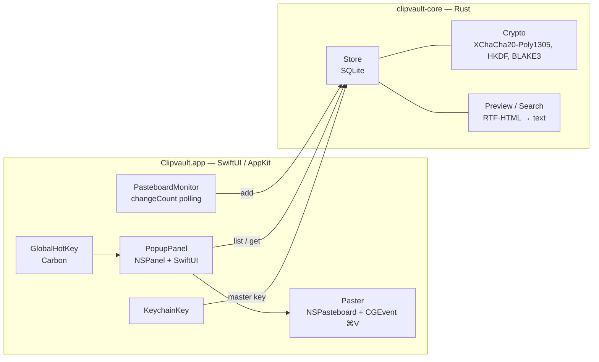

<div align="center">

# 🔐 Clipvault

**Зашифрованная история буфера обмена за последние 24 часа для macOS**

Нажмите <kbd>⇧</kbd><kbd>⌘</kbd><kbd>V</kbd>, найдите нужный фрагмент и вставьте его. Всё хранится локально в зашифрованном виде и удаляется через сутки.


</div>

---

## Возможности

- ⌨️ **Глобальная горячая клавиша**: <kbd>⇧⌘V</kbd> по умолчанию, меняется в настройках.
- 📋 **Все основные форматы**: текст, RTF, HTML, изображения (с миниатюрами) и файлы. При вставке восстанавливаются все представления, поэтому форматирование сохраняется.
- ⚡ **Автовставка**: выбранная запись вставляется прямо в приложение, где вы работали.
- 🔎 **Мгновенный поиск** по тексту, путям файлов и названию приложения-источника.
- 🔐 **Шифрование каждой записи**: XChaCha20-Poly1305, ключ хранится в macOS Keychain.
- ⏳ **Хранение 24 часа**: просроченные записи скрываются сразу и удаляются из базы с затиранием.
- 🙈 **Не сохраняет пароли**: игнорирует содержимое, помеченное менеджерами паролей (1Password, KeePassXC и др.) как скрытое или временное.
- 🪶 **Экономичность**: работает только в меню-баре без иконки в Dock, данные читаются только при изменении буфера, мониторинг засыпает вместе с системой.

## Управление

| Клавиши | Действие |
|---|---|
| <kbd>⇧⌘V</kbd> | Показать/скрыть историю |
| Ввод текста | Поиск (все слова, без учёта регистра) |
| <kbd>↑</kbd> <kbd>↓</kbd> | Выбор записи |
| <kbd>⏎</kbd> / двойной клик | Вставить |
| <kbd>⌘1</kbd> … <kbd>⌘9</kbd> | Вставить запись по номеру |
| <kbd>⌘⌫</kbd> | Удалить запись |
| <kbd>Esc</kbd> | Закрыть |

В меню-баре доступны пауза записи, включение и выключение автовставки, очистка истории и настройки.

## Установка

Готовых сборок пока нет, приложение собирается из исходников.

**Нужно:** macOS 14+, [Rust](https://rustup.rs) и Swift toolchain. Хватает Command Line Tools (`xcode-select --install`), полный Xcode не обязателен.

```sh
git clone https://github.com/Kamaliev/clipvault.git
cd clipvault
make run                      # соберёт build/Clipvault.app и запустит его
```

Чтобы установить приложение насовсем, скопируйте `build/Clipvault.app` в `/Applications`.

### Разрешения

| Разрешение | Зачем | Без него |
|---|---|---|
| **Универсальный доступ** (Accessibility) | Отправить <kbd>⌘V</kbd> в активное приложение | Запись только копируется в буфер, вставлять нужно вручную |
| **Keychain** | Хранить ключ шифрования | История хранится только в памяти до перезапуска |

> [!NOTE]
> По умолчанию сборка подписывается ad-hoc. После каждой пересборки подпись меняется, поэтому macOS
> может заново спросить доступ к Keychain и сбросить Accessibility. Чтобы этого не было, подпишите приложение
> своим сертификатом: `SIGN_IDENTITY="Apple Development: …" make app`.

## Безопасность

```
master key (32 байта, Keychain)
   └─ HKDF-SHA256 ─┬─ ключ шифрования → XChaCha20-Poly1305 (случайный nonce на каждый блоб)
                   └─ ключ хеша     → keyed BLAKE3 (дедупликация без раскрытия содержимого)
```

- **Что шифруется:** содержимое всех форматов, превью, поисковый текст, название приложения-источника и миниатюры.
- **Что хранится открыто:** только id, тип записи (текст, картинка и т.д.), время и размер.
- **Целостность:** AAD привязывает каждый блоб к его записи, поэтому подмена или перестановка данных в базе обнаруживается.
- **Удаление:** SQLite `secure_delete=ON`, журнал без WAL; права `0700` на каталог и `0600` на файл.
- **Ключ:** создаётся при первом запуске (`SecRandomCopyBytes`) с атрибутом `AfterFirstUnlockThisDeviceOnly`, поэтому не попадает в iCloud и бэкапы на другие устройства. В памяти Rust ключи затираются (`zeroize`).
- **Потеря ключа:** если ключ удалён из Keychain, старую историю расшифровать нельзя, и база пересоздаётся автоматически.

**Модель угроз.** Clipvault защищает историю на диске: от кражи диска или бэкапа, от других пользователей
системы и от программ, которые просто читают файлы. От вредоносного кода, запущенного под вашим пользователем
с доступом к вашему Keychain или к самому буферу обмена, он не защищает. Этого не может ни один менеджер буфера обмена.

База данных: `~/Library/Application Support/Clipvault/history.db`

## Архитектура



Swift-часть отвечает за всё, что связано с macOS: меню-бар, окно, горячую клавишу, буфер обмена, Keychain и вставку.
Rust-ядро отвечает за хранение, шифрование, срок жизни записей, дедупликацию, извлечение текста из RTF и HTML и поиск.
Связка сделана через [UniFFI](https://github.com/mozilla/uniffi-rs): Swift-биндинги генерируются из Rust-кода при сборке,
а ядро линкуется статической библиотекой.

```
.
├── core/                 # Rust crate clipvault-core
│   ├── src/
│   │   ├── crypto.rs     # AEAD, HKDF, keyed hash
│   │   ├── store.rs      # SQLite, TTL, дедупликация, UniFFI API
│   │   ├── preview.rs    # определение типа, RTF/HTML → текст, поиск
│   │   └── model.rs      # типы, экспортируемые в Swift
│   └── tests/store.rs
├── app/                  # Swift Package (+ project.yml для xcodegen)
│   ├── Sources/Clipvault/
│   └── Resources/Info.plist
├── scripts/
│   ├── build-core.sh     # cargo build → .a + генерация биндингов
│   └── bundle-app.sh     # swift build → Clipvault.app + codesign
└── Makefile
```

## Разработка

```sh
make test       # тесты Rust-ядра
make lint       # clippy -D warnings
make core       # только ядро и биндинги
make app        # собрать .app
make xcode      # сгенерировать Xcode-проект (нужны xcodegen и Xcode)
make clean
```

| Переменная | Назначение |
|---|---|
| `UNIVERSAL=1` | Universal binary arm64 + x86_64 (сначала выполните `rustup target add x86_64-apple-darwin`) |
| `SIGN_IDENTITY` | Сертификат для `codesign` (по умолчанию `-`, т.е. ad-hoc) |
| `PROFILE=debug` | Отладочная сборка ядра |

Окно истории можно открыть и без горячей клавиши, например из Shortcuts или скрипта:

```sh
osascript -l JavaScript -e "ObjC.import('Foundation'); \$.NSDistributedNotificationCenter.defaultCenter.postNotificationNameObjectUserInfoDeliverImmediately('com.kamaliev.clipvault.toggle', \$(), \$(), true)"
```

## Ограничения и планы

- [ ] Подписанные и нотаризованные релизы
- [ ] Закрепление записей (без удаления через 24 ч)
- [ ] Настраиваемый срок хранения и список исключённых приложений
- [ ] Автозапуск при входе в систему
- [ ] OCR для поиска по изображениям
- Для файлов сохраняются только пути, не содержимое.
- Автовставка отправляет код клавиши `V` раскладки ANSI. В раскладках вроде Dvorak она может не сработать.

## Лицензия

[MIT](LICENSE)
